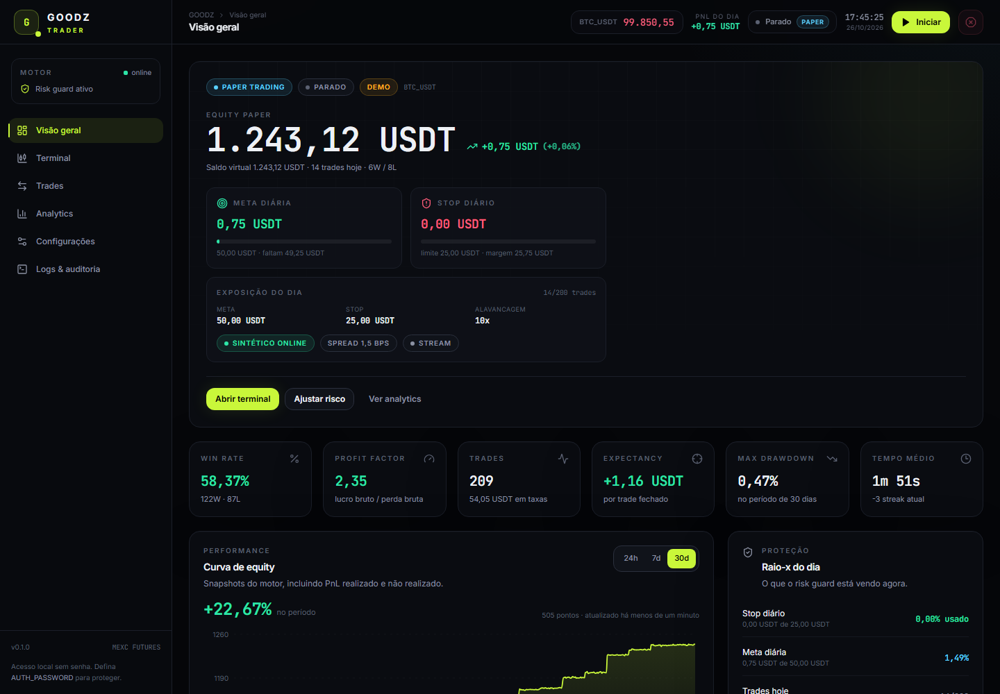
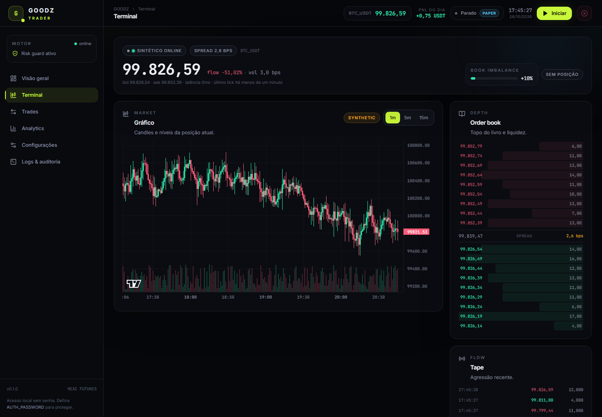
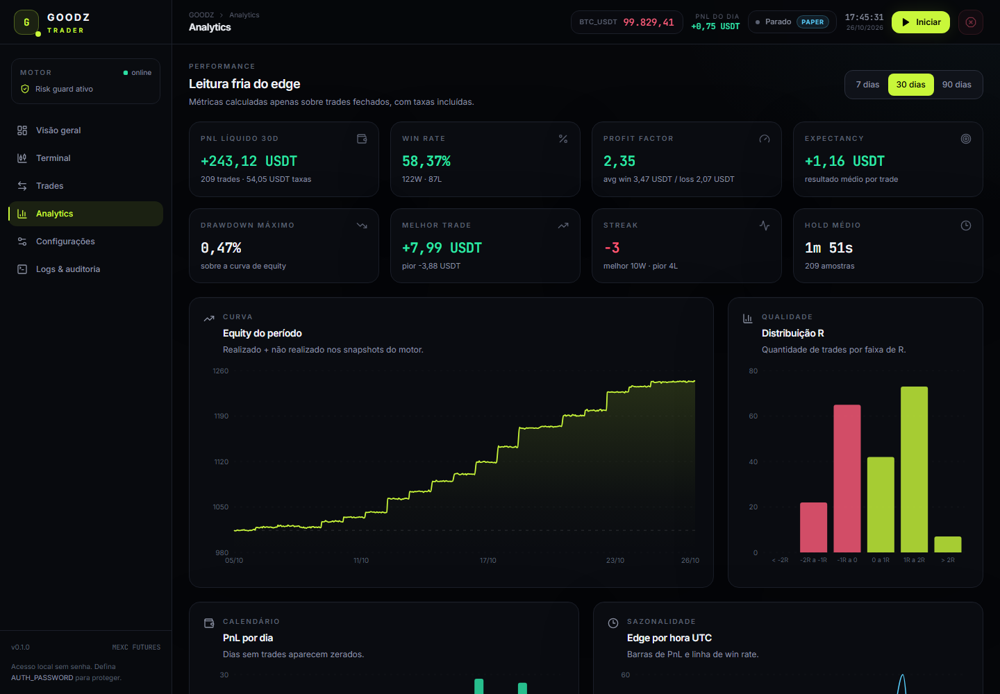
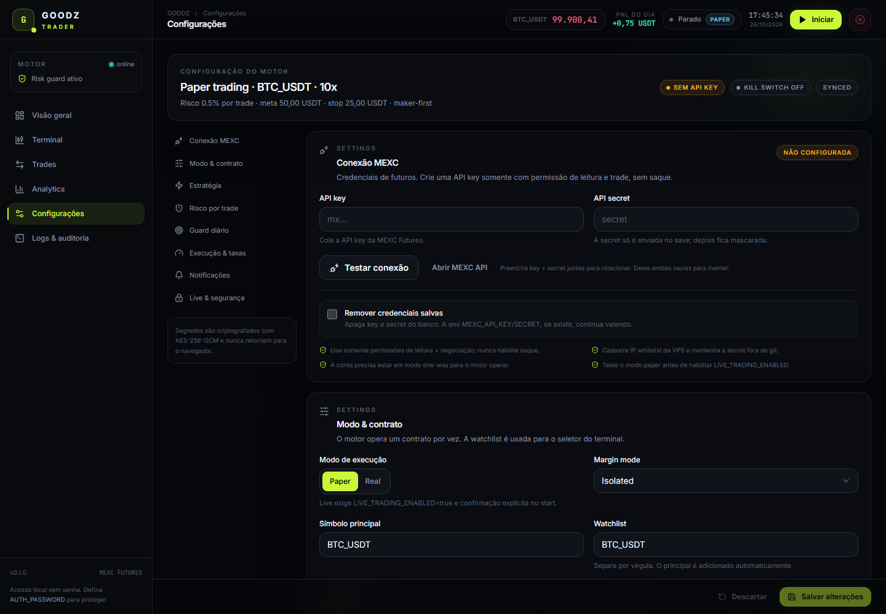
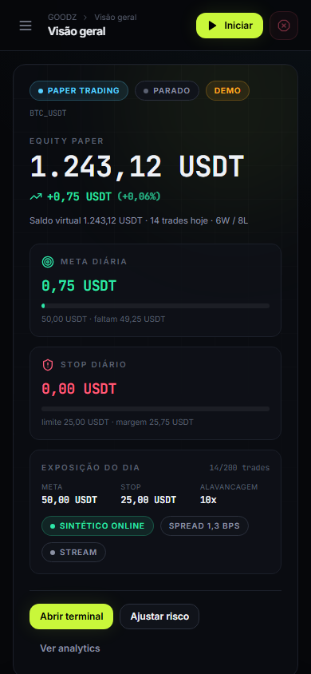

# Goodz Trader

**MEXC Futures scalping engine + real-time risk dashboard.** Paper-first, fee-aware,
single-user, self-hosted.

[](https://github.com/KayzenRoot/goodz-trader/actions/workflows/ci.yml)
[](https://github.com/KayzenRoot/goodz-trader/actions/workflows/codeql.yml)
[](https://codecov.io/gh/KayzenRoot/goodz-trader)
[](https://github.com/KayzenRoot/goodz-trader/actions/workflows/scorecard.yml)
[](LICENSE)

> **Risk warning.** Leveraged futures can lose more than your initial margin. This is
> experimental trading software, not financial advice, and it does not guarantee profit.
> The live path is implemented but must be validated by you with the smallest possible
> notional on a flat, one-way account. Default state is **paper** with **live trading off**.

## Screenshots

| Overview                                   | Terminal                                   |
| ------------------------------------------ | ------------------------------------------ |
|  |  |

| Analytics                                    | Settings                                   |
| -------------------------------------------- | ------------------------------------------ |
|  |  |

<p align="center">
  
</p>

Demo data is synthetic and clearly labeled. See [docs/screenshots](docs/screenshots/README.md).

## What it does

- Connects to the MEXC USDT-perpetual contract API (signed REST + public WebSocket).
- Runs a fast **momentum + order-flow scalper** with maker-first entries, timeout and
  optional taker fallback.
- Sizes every order from a hard risk budget: max leverage, notional, margin, spread,
  trades/day, orders/minute, consecutive-loss cooldown.
- Enforces a **daily profit target** and **daily loss stop** net of fees, with automatic
  halt, kill switch and manual close.
- Persists a full ledger in SQLite (trades, orders, fees, equity snapshots, daily stats,
  audit log) and streams live state over WebSocket.
- Ships a complete dashboard: overview, terminal (chart/order book/tape), trades,
  analytics, settings and logs/audit.
- Seeds deterministic **demo data** so the dashboard is useful offline before any key is
  configured. Demo rows are visibly marked.

## Stack

| Layer    | Technology                                                                                  |
| -------- | ------------------------------------------------------------------------------------------- |
| Web      | React 19, Vite, Tailwind CSS v4, TanStack Query, Zustand, Recharts, lightweight-charts      |
| API      | Fastify 5, Zod, WebSocket, Helmet, rate limit, cookie sessions                              |
| Engine   | TypeScript, event-driven state machine, paper/live brokers                                  |
| Domain   | `@goodz/core` — schemas, strategy, risk guard, PnL, analytics                               |
| Exchange | `@goodz/mexc` — HMAC SHA256 REST client + public WS                                         |
| Ledger   | SQLite WAL (`better-sqlite3`), migrations, parameterized SQL                                |
| Tooling  | pnpm workspaces, Turborepo, Vitest, Playwright, ESLint, Prettier, CodeQL, Semgrep, Gitleaks |

## Quickstart (paper mode)

Prerequisites: **Node.js 22+**, **pnpm 11+**.

```powershell
corepack enable
pnpm install
Copy-Item .env.example .env   # optional in dev; defaults are safe
pnpm dev
```

- Dashboard: <http://localhost:5173>
- API/health: <http://localhost:3001/api/health>

The first boot creates `.data/goodz.db`, a locally generated dev secret and 200+ demo
trades. Click **Iniciar** to run the synthetic scalper in paper mode. No MEXC key is needed.

Production-style single port:

```powershell
pnpm build
pnpm start
# serves the built dashboard and API on http://localhost:3001
```

## Configure the bot

Open **Configurações** in the dashboard. Everything the engine uses is there:

- **Conexão MEXC** — API key/secret, encrypted at rest, masked in responses, test button.
- **Modo & contrato** — paper/live, symbol, watchlist, leverage, isolated/cross, feed.
- **Estratégia** — EMA fast/slow, trend bps, book imbalance, trade delta, TP/SL, trailing,
  time stop, cooldown, maker timeout, taker fallback.
- **Risco por trade** — risk %, max notional, max margin, trades/day, orders/min,
  consecutive losses, spread, min equity.
- **Guard diário** — daily profit target, daily loss limit, UTC reset hour, stop on target,
  close on stop.
- **Execução & taxas** — maker/taker fees, slippage, kill switch.
- **Notificações** — Telegram and generic webhook.
- **Live & segurança** — server live flag, confirmation phrase, auth status, risk warnings.

Secrets are encrypted with AES-256-GCM using `APP_SECRET`; the API never returns the plain
key or secret. Set `AUTH_PASSWORD` before exposing the dashboard beyond localhost.

## Live trading checklist

Do not skip any item.

1. Validate the strategy in **paper mode** for enough trades to see fees and drawdown.
2. Create a MEXC API key with **read + trade only**, no withdrawal, and an IP whitelist.
3. Put the account in **one-way** mode and close all positions/orders.
4. Set `LIVE_TRADING_ENABLED=true`, `APP_SECRET` (32+ chars) and `AUTH_PASSWORD`, restart.
5. In Settings, select **Real**, save key/secret, test the connection, set leverage and a
   small daily loss limit. Start with the minimum notional.
6. Click **Iniciar**, read the warning, type `CONFIRMO TRADING REAL` and confirm.
7. Watch the first trades. Use **Kill switch** immediately if behavior diverges.

The engine refuses live start if the flag is off, credentials are missing, the phrase is
wrong, the account is in hedge mode, a position is already open, or kill switch is active.

## Risk model (hard limits)

- Risk per trade is derived from the stop distance, then capped by max notional, max margin
  and available balance.
- One position by default; no pyramiding.
- Daily guard uses **net PnL including fees** and unrealized PnL.
- Halt reasons: `daily_stop`, `daily_target`, `consecutive_losses`, `max_trades`,
  `kill_switch`, `error`.
- A halted bot never auto-resumes. The kill switch persists until disabled.
- Feed staleness (>5s), wide spread, missing credentials and API-disabled contracts block
  entries.

See [docs/TRADING_SAFETY.md](docs/TRADING_SAFETY.md) for the full checklist and known
limitations.

## MEXC specifics

- Base REST: `https://contract.mexc.com` — public WS: `wss://contract.mexc.com/edge`.
- Requests are signed with `HMAC_SHA256(apiKey + timestamp + paramString)`, headers
  `ApiKey`, `Request-Time`, `Signature`.
- Fees are read from contract metadata; the validator requires `takeProfitBps` to exceed the
  round-trip fee + 2 bps.
- Order/cancel docs are historically labeled "under maintenance" but query endpoints are
  active. Validate live semantics with a tiny order — see [docs/MEXC.md](docs/MEXC.md).
- API permissions: **read + trade**, never withdrawal. IP whitelist is mandatory.

## Quality gates

```bash
pnpm format:check
pnpm lint
pnpm typecheck
pnpm test
pnpm test:coverage
pnpm build
pnpm e2e
```

CI runs formatting, lint, typecheck, unit/integration coverage, build and Playwright E2E.
CodeQL, Semgrep, Gitleaks, dependency review, Dependabot and OpenSSF Scorecard run on the
public repository. The `main` ruleset requires a PR, a linear history and the
**Quality Gate** + **CodeQL** checks. See [docs/engineering/QUALITY_GATES.md](docs/engineering/QUALITY_GATES.md).

## Repository map

```
apps/web        React dashboard (Overview, Terminal, Trades, Analytics, Settings, Logs)
apps/api        Fastify API, bot engine, brokers, SQLite repository, auth, WS
packages/core   schemas, strategy, risk guard, PnL, analytics (high test coverage)
packages/mexc   signed REST client, public WS, contract/order mappers
docs            architecture, safety, MEXC notes, runbook, ADRs, roadmap
.opencode       ECC-adapted instructions, commands, agents, rules
skills          selected ECC skills (TDD, security, E2E, verification, patterns)
.github         CI, CodeQL, security, Dependabot, issue/PR templates, CODEOWNERS
```

## Roadmap & issues

The production guide lives in **GitHub Issues + Milestones**. See
[docs/ROADMAP.md](docs/ROADMAP.md) for the map. Completed foundation issues are closed with
evidence; open issues are the backlog. No work should start without an issue or explicit
user request.

## ECC integration

Selected components of [affaan-m/ECC](https://github.com/affaan-m/ECC) (MIT, v2.2.3) are
adapted for OpenCode: engineering rules, planner/reviewer/TDD/E2E agents, commands and 12
skills. Hooks/plugin runtime and the full 311-skill catalog are intentionally excluded.
See [docs/engineering/ECC.md](docs/engineering/ECC.md).

## Deploy

```bash
cp .env.example .env   # set APP_SECRET, AUTH_PASSWORD, LIVE_TRADING_ENABLED=false
docker compose up -d --build
```

The API serves the built SPA on port 3001. SQLite lives in the `goodz-data` volume. Read
[docs/RUNBOOK.md](docs/RUNBOOK.md) before exposing it to the internet.

## License

MIT © 2026 KayzenRoot. See [LICENSE](LICENSE).

**Not financial advice. Use at your own risk.**
